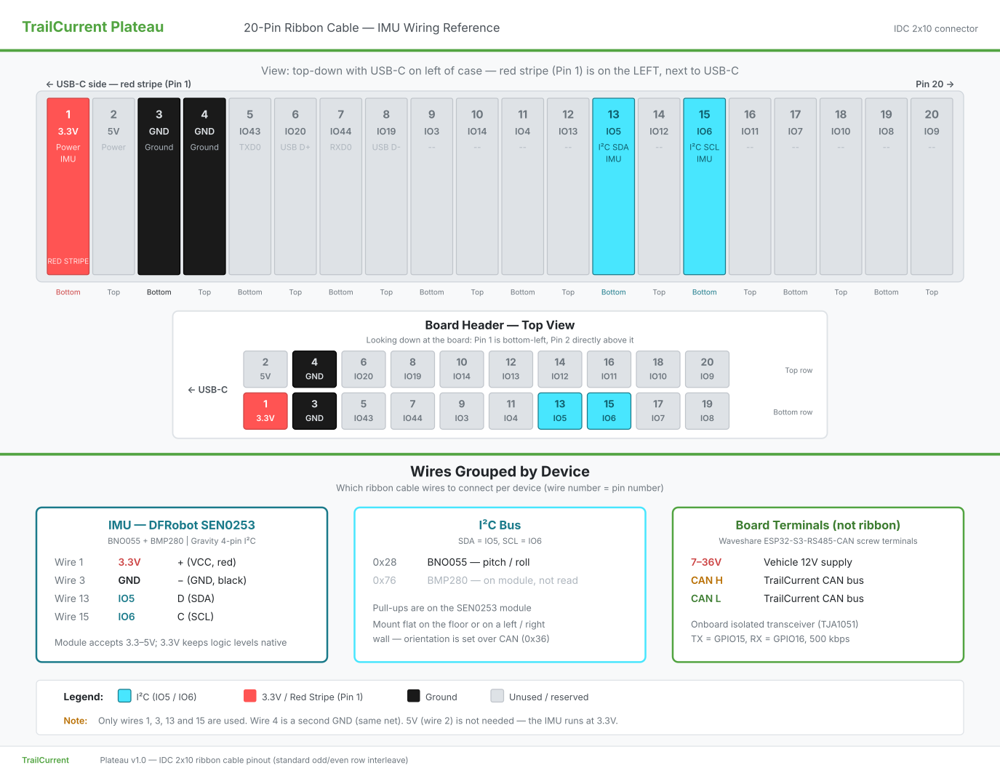

# TrailCurrent Plateau

Vehicle leveling module that monitors trailer tilt angles and computes per-corner height adjustments via a CAN bus interface with OTA firmware update capability. Part of the [TrailCurrent](https://trailcurrent.com) open-source vehicle platform.

## Hardware Overview

- **Microcontroller:** ESP32-S3 ([Waveshare ESP32-S3-RS485-CAN](https://www.waveshare.com/esp32-s3-rs485-can.htm))
- **IMU:** [DFRobot SEN0253](https://wiki.dfrobot.com/sen0253/) Gravity 10-DOF AHRS (Bosch BNO055)
- **Function:** Vehicle leveling with CAN bus communication
- **Key Features:**
  - BNO055 IMU for pitch/roll measurement with auto-calibration
  - Per-corner height adjustment calculation from vehicle dimensions
  - Three mounting orientations (floor, left wall, right wall) with axis remapping
  - CAN bus communication at 500 kbps
  - Vehicle configuration (dimensions, mounting) received via CAN and stored in NVS
  - Over-the-air (OTA) firmware updates via WiFi (credentials provisioned via CAN)
  - mDNS-based device discovery for Headwaters integration
  - Custom flash partition layout with dual OTA slots

## Hardware Requirements

Plateau is built entirely from off-the-shelf modules wired together — there is no custom PCB.



### Bill of Materials

| Qty | Part | Notes |
|-----|------|-------|
| 1 | [Waveshare ESP32-S3-RS485-CAN](https://www.waveshare.com/esp32-s3-rs485-can.htm) | ESP32-S3R8 (8MB PSRAM, 16MB flash), built-in isolated CAN transceiver (TJA1051), built-in isolated RS485 transceiver (unused), 7-36V DC input or 5V USB-C — runs directly from the vehicle 12V supply |
| 1 | [DFRobot SEN0253](https://wiki.dfrobot.com/sen0253/) Gravity 10-DOF AHRS | Bosch BNO055 IMU (I2C 0x28) + BMP280 (unused). Ships with a Gravity 4-pin I2C cable |
| 1 | 20-pin IDC 2x10 ribbon cable | Connects to the board's user header; only wires 1, 3, 13 and 15 are used |
| 1 | Enclosure | FreeCAD design in [`CAD/`](CAD/) |

### Pin Connections

| IDC Pin | GPIO | Function |
|---------|------|----------|
| 1 | — | 3.3V → IMU VCC |
| 3 | — | GND → IMU GND |
| 13 | 5 | I2C SDA (BNO055) |
| 15 | 6 | I2C SCL (BNO055) |
| — | 15 | CAN TX (onboard transceiver) |
| — | 16 | CAN RX (onboard transceiver) |

CAN H / CAN L and 7-36V power land on the board's screw terminals, not the ribbon cable. See [DOCS/plateau-ribbon-cable.png](DOCS/plateau-ribbon-cable.png) for the full wiring reference.

## Firmware

ESP-IDF native firmware in the `main/` directory.

**Prerequisites:**
- [ESP-IDF](https://docs.espressif.com/projects/esp-idf/en/latest/esp32s3/get-started/) v5.2 or later

**Build and flash:**
```bash
# Set ESP-IDF target
idf.py set-target esp32s3

# Build firmware
idf.py build

# Upload to board (serial)
idf.py flash

# Monitor serial output
idf.py monitor

# Build, flash, and monitor in one command
idf.py build flash monitor
```

**Release build (`build-all.sh`):**

```bash
./build-all.sh
```

Produces both release binaries:

| File | Use |
|------|-----|
| `build/plateau.bin` | App-only image — OTA via Headwaters or `curl` |
| `build/plateau_merged.bin` | Bootloader + partition table + OTA data + app — web flasher, or direct flash at `0x0` |

Never use the merged binary for OTA: it starts with the bootloader, not an app header, and fails `esp_ota_end` validation.

**Direct flash of the merged binary:**
```bash
esptool.py --chip esp32s3 write_flash 0x0 build/plateau_merged.bin
```

**OTA update (after initial flash):**
```bash
curl -X POST http://esp32-XXYYZZ.local/ota --data-binary @build/plateau.bin
```

### Flash Layout

16MB flash, DIO mode, dual OTA slots (`partitions.csv`):

| Partition | Offset | Size |
|-----------|--------|------|
| nvs | 0x9000 | 20KB |
| otadata | 0xE000 | 8KB |
| app0 (ota_0) | 0x10000 | 5.9MB |
| app1 (ota_1) | 0x600000 | 5.9MB |
| spiffs | 0xBF0000 | 4.1MB |

### Firmware Architecture

The firmware uses FreeRTOS tasks for concurrent operation:

| Task | Priority | Stack | Function |
|------|----------|-------|----------|
| twai | 5 | 4096 | CAN bus RX/TX, leveling computation, IMU reads |
| ota | 3 | 8192 | OTA update (spawned on demand, non-blocking) |
| discovery | 3 | 8192 | mDNS discovery (spawned on demand, non-blocking) |

OTA and discovery run as separate tasks to avoid blocking CAN bus communication. Mutual exclusion prevents both from running simultaneously.

### Source Files

| File | Purpose |
|------|---------|
| `main.c` | Application entry, TWAI task, leveling logic, CAN protocol |
| `bno055.c/h` | BNO055 IMU driver for the DFRobot SEN0253 (ESP-IDF I2C master, 100 kHz) |
| `wifi_config.c/h` | WiFi credentials, connect/disconnect, CAN provisioning |
| `ota.c/h` | Task-based OTA with HTTP server and mDNS |
| `discovery.c/h` | Task-based mDNS discovery for Headwaters |

### CAN Bus Protocol

- **Receive ID `0x00`:** OTA update trigger — initiates firmware update when device MAC matches
- **Receive ID `0x01`:** WiFi credential provisioning — multi-frame protocol to store SSID/password in NVS
- **Receive ID `0x02`:** Discovery trigger — joins WiFi, advertises via mDNS, waits for Headwaters confirmation
- **Transmit ID `0x04`:** Firmware version report — sent once on boot: `[mac3, mac4, mac5, major, minor, patch]`
- **Receive ID `0x36`:** Leveling configuration — set mounting surface, vehicle length/width, persist to NVS
- **Transmit ID `0x37`:** Tilt data — pitch/roll angles (×100) and front-back/left-right height diffs in mm
- **Transmit ID `0x38`:** Corner data — per-corner height adjustments in mm (normalized, lowest = 0)
- **Transmit ID `0x39`:** Status data — IMU connection, calibration levels, mounting orientation
- *(Plateau CAN IDs were reallocated 2026-05-19 from the original 0x20/0x30/0x31/0x32 block to the contiguous 0x36-0x39 block when Borealis claimed 0x20 for its safety frame.)*
- CAN speed: 500 kbps

### WiFi Credentials

WiFi credentials are provisioned over the CAN bus (ID `0x01`) and stored in NVS. No hardcoded credentials or secrets files needed.

## Project Structure

```
├── EDA/                          # Archived KiCAD design from an earlier custom-PCB revision (no longer used)
├── CAD/                          # FreeCAD enclosure design
├── main/                         # ESP-IDF firmware source
│   ├── main.c                    # Application entry, TWAI task, leveling logic
│   ├── bno055.c/h                # BNO055 IMU I2C driver
│   ├── wifi_config.c/h           # WiFi credentials and CAN provisioning
│   ├── ota.c/h                   # OTA firmware update (task-based)
│   ├── discovery.c/h             # mDNS device discovery (task-based)
│   ├── CMakeLists.txt            # Component build configuration
│   └── idf_component.yml         # ESP-IDF component dependencies
├── CMakeLists.txt                # Root ESP-IDF project file
├── DOCS/                         # Ribbon cable wiring diagram (SVG source + PNG)
├── build-all.sh                  # Release build: OTA + merged (web flasher) binaries
├── sdkconfig.defaults            # ESP-IDF build defaults
├── partitions.csv                # 16MB flash partition layout (dual OTA)
├── LICENSE                       # MIT License
└── README.md                     # This file
```

## License

MIT License - See LICENSE file for details.

You are free to use, modify, and distribute these designs for personal or commercial purposes.

## Contributing

Improvements and contributions are welcome! Please submit issues or pull requests.
